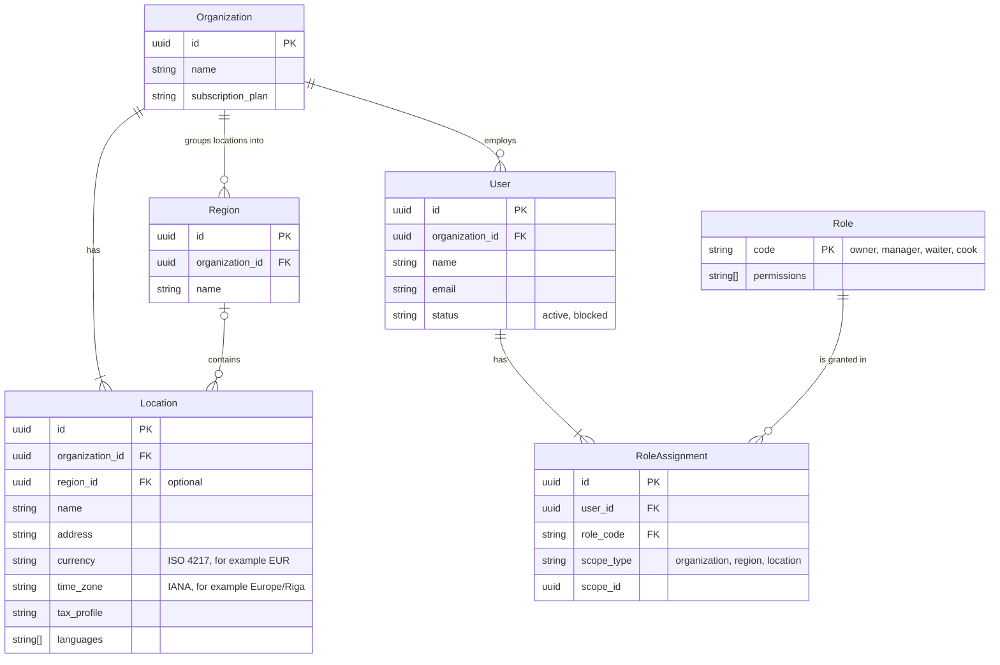
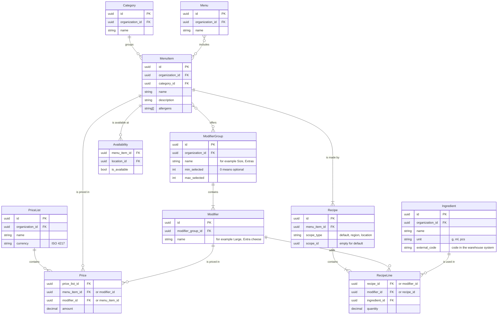
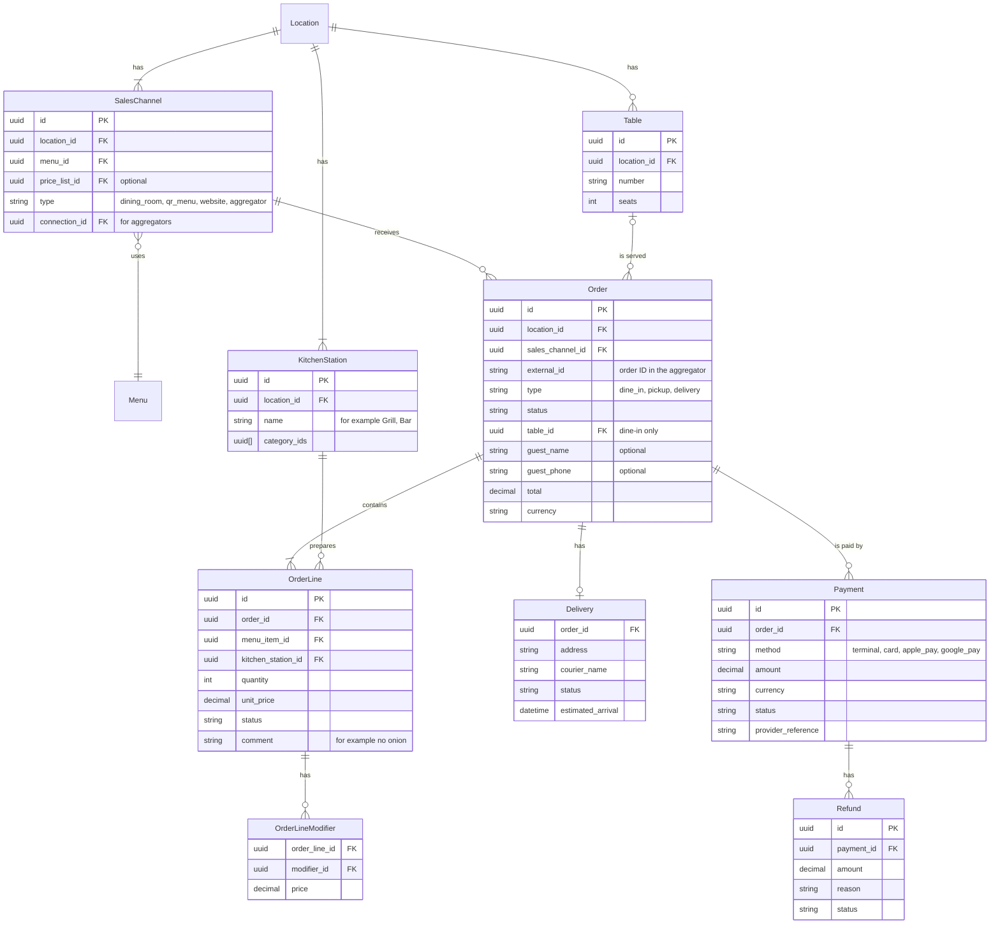
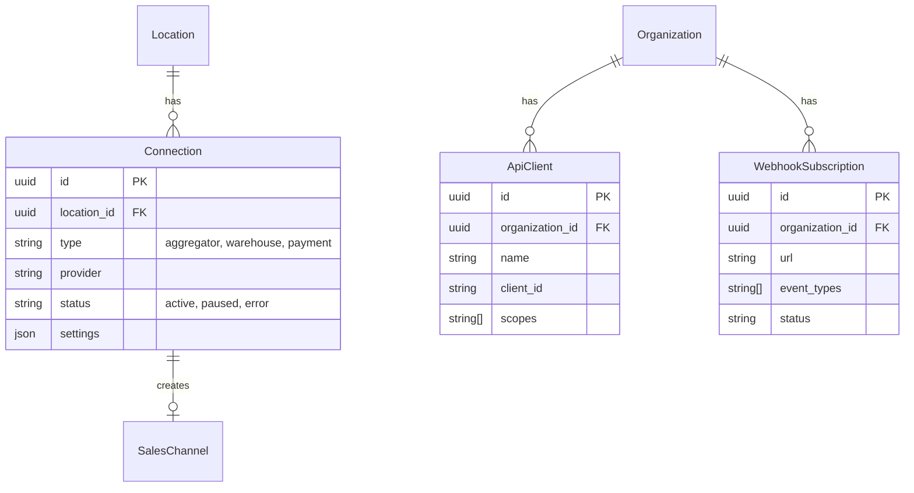

# Data model

This page describes the ServeFlow domain model: the business entities,
their key attributes, and the relationships between them. It's a logical
model. It doesn't define database tables, indexes, or technical fields
such as `created_at`.

The model has four areas:

- [Organization and access](#organization-and-access): customers,
  locations, users, and permissions.
- [Menu](#menu): what a customer sells and for how much.
- [Orders and payments](#orders-and-payments): what guests order and how
  they pay.
- [Integrations](#integrations): connections to external systems.

## Organization and access

An **organization** is a ServeFlow customer: one company with one
subscription. An organization has one or more **locations**. Locations can
form **regions**, so that a regional manager can work with a group of
locations.

A **user** gets access through **role assignments**. Each role assignment
links a user to a role within a scope: one location, one region, or the
whole organization. One user can have several role assignments.

| Entity | Description |
|---|---|
| Organization | A ServeFlow customer. Owns all other data. |
| Region | A named group of locations, for example "Latvia" or "Riga". A location belongs to one region or to none. |
| Location | A place that sells and prepares food: a restaurant, café, bar, or dark kitchen. Stores the country-specific settings: currency, time zone, taxes, and languages. |
| User | A person who works with ServeFlow: an owner, manager, waiter, or cook. Guests aren't users. |
| Role | A set of permissions. ServeFlow provides a fixed list of roles. |
| Role assignment | Grants a role to a user within a scope. For example, "Waiter in Riga Center" or "Manager in the Latvia region". |

## Menu

A **menu item** is anything a customer sells: a dish, a drink, or a
combo. The organization defines each menu item once. **Categories** group
menu items, for example "Soups" or "Drinks".

A **menu** is a named set of menu items, for example "Dining room menu"
or "Delivery menu". One menu item can be in several menus. Each sales
channel of a location uses one menu.

**Modifier groups** contain **modifiers**: options that a guest selects
for a menu item, such as size or extra toppings. A modifier group sets
how many modifiers a guest can select. One modifier group can be attached
to many menu items, and one menu item can have many modifier groups.

A **price list** sets prices in one currency for menu items and
modifiers. Each location uses one price list. A sales channel can use its
own price list, for example to set higher prices on a delivery
aggregator.

A **recipe** lists the **ingredients** of a menu item. A menu item has
one default recipe and can have recipe variants for a region or location.
A modifier can also use ingredients: "Extra cheese" adds 30 g of cheese.
ServeFlow uses recipes to report ingredient usage to the warehouse
system.

**Availability** controls whether a menu item is on sale at a location.
An unavailable menu item is on the stop list.

| Entity | Description |
|---|---|
| Menu item | A dish, drink, or combo. Has a name, description, and allergens. Has no price: prices come from price lists. |
| Category | A section of the menu, for example "Soups". |
| Menu | A named set of menu items that a sales channel uses. |
| Modifier group | A set of options for a menu item with selection rules. "Size: select exactly 1" or "Extras: select up to 3". |
| Modifier | One option in a modifier group. Can have a price and can use ingredients. |
| Price list | Prices in one currency. Assigned to locations and, optionally, to sales channels. |
| Price | The price of one menu item or one modifier in one price list. |
| Recipe | The ingredients of a menu item. The default recipe applies everywhere unless a region or location has its own variant. |
| Recipe line | One ingredient and its quantity in a recipe or a modifier. |
| Ingredient | A product that the kitchen uses. Has a code that matches the warehouse system. |
| Availability | Whether a menu item is on sale at a location. |

### One dish, one menu item

If guests, the kitchen, and reports treat two things as the same dish, they're
one menu item. Different prices or recipe variants in different
countries don't create a new menu item. A different name or a different
description on the menu does.

## Orders and payments

An **order** comes from one **sales channel** of a location: the dining
room, the QR menu, the website, or a delivery aggregator. An order
contains **order lines**. Each order line is one menu item with its
selected modifiers.

The kitchen works with order lines, not with whole orders. Each order line
goes to a **kitchen station**, such as the grill or the bar. A station
prepares the menu items of the categories assigned to it.

A dining room order belongs to a **table**. A delivery order has a
**delivery**: the courier and delivery status that the aggregator
reports.

An order can have several **payments**, for example when guests split
the bill. A payment can have **refunds**.

| Entity | Description |
|---|---|
| Sales channel | A way a location sells: dining room, QR menu, website, or a specific delivery aggregator. Defines which menu and price list apply. |
| Order | A guest order. Stores only the guest contact data that the channel provides. See [Guest data](#guest-data). |
| Order line | One menu item in an order with its quantity, price, comment, and kitchen status. |
| Order line modifier | A modifier that the guest selected for an order line, with its price at the time of the order. |
| Kitchen station | A part of the kitchen that prepares certain categories, for example the grill or the bar. |
| Table | A table in the dining room. |
| Delivery | Delivery details from the aggregator: address, courier, status, and estimated arrival. |
| Payment | A payment for an order: on a payment terminal, by card, by Apple Pay, or by Google Pay. |
| Refund | A full or partial refund of a payment. |

### Guest data

ServeFlow doesn't store guests as a separate entity. An order stores only
the contact data that its sales channel provides:

| Sales channel | Guest data in the order |
|---|---|
| Delivery aggregator | First name, delivery address, and a phone number if the aggregator provides one |
| Website, QR menu | Name and phone number for pickup or delivery |
| Dining room | None. The order belongs to a table. |

## Integrations

A **connection** links a location to an external system: a delivery
aggregator, a warehouse system, or a payment provider. An aggregator
connection creates a sales channel.

An organization's IT team or integrator uses **API clients** to call the
ServeFlow API and **webhook subscriptions** to receive events.

| Entity | Description |
|---|---|
| Connection | A link between a location and an external system, with its settings and status. |
| API client | Credentials that an integrator uses to call the ServeFlow API. Scopes limit what the client can do. |
| Webhook subscription | An endpoint that receives ServeFlow events, such as order status changes. |

## Assumptions to confirm

- A menu is a named set of menu items that a sales channel uses. Menus
  have no time schedules, such as "Breakfast until 11:00".
- A sales channel can override the location price list.
- Kitchen stations get order lines by category.
- Table reservations are out of scope.
- ServeFlow doesn't store hardware devices, such as kitchen displays, as
  entities.
